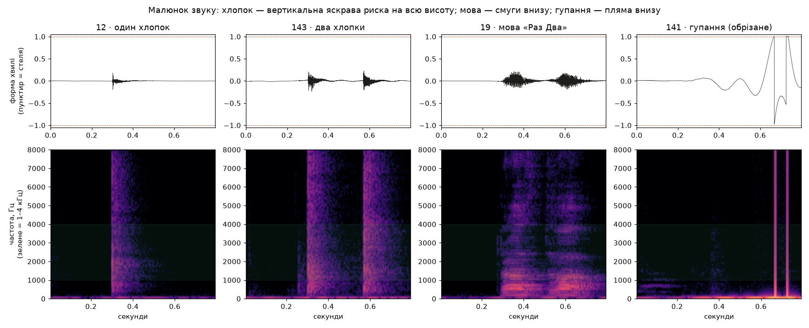

# clap-light

Хлоп-хлоп, і світло перемикається. Частина домашнього хабу на Raspberry Pi.

```
INMP441 ──I2S──> ESP32-S3: детектор хлопків ──Wi-Fi, GET /toggle──> Pi :7076 (server/main.py, FastAPI) ──Tuya 3.3──> лампи Ledvance SMART+ WiFi
                                     └── GET /event ──> Pi: лог у data/AAAA-MM-DD.csv
```

Звук нікуди не йде. Хлопок визначає плата, з неї виходить лише команда «перемкни». Pi нічого не вирішує, тільки виконує і пише лог. Усе по LAN, без хмари.

## Прошивка

```
firmware/src/
  main.cpp      цикл: mic → level → ring → clap → intent → net
  config.h      піни, пороги, адреса Pi, CLIP_UPLOAD
  hw/           залізо й мережа (ESP-IDF)
    mic         I2S: mic_init(), mic_read()
    net         Wi-Fi, задача відправки з черги: POST /clip, GET /event, пізніше GET /toggle
  detect/       чиста логіка без ESP-заголовків (тести на Mac)
    level       DC-фільтр, RMS і пік вікна 10 мс
    ring        остання 1 с звуку, старе перезаписується саме
    clap        (крок 3) вікна → «був хлопок» + його час
    intent      (крок 5) часи хлопків → INTENT_TOGGLE / NONE; пізніше сюди ж wake-слово
```

Усе в `detect/` без ESP-заголовків, час передається параметром. Так їх можна тестувати на Mac. `intent` вирішує лише після кінця вікна ~700 мс, інакше третій хлопок не встигне скасувати.

### Кліпи для налаштування (`CLIP_UPLOAD 1` у `config.h`, потім 0)

Щоб розбирати хибні спрацювання й пропуски на слух:

- Кожна подія, гучніша за поріг кандидата, дає кліп: ~300 мс до і ~500 мс після (з `ring`). Подвійний хлопок — один кліп на пару.
- Мітка детектора: `відкинуто / хлопок / два хлопки`. Хибне = «хлопок», а там двері; пропуск = «відкинуто», а там хлопок.
- 16 кГц, 16 біт, моно: ~26 КБ на кліп. Відправка в окремій задачі через чергу, аудіо-цикл не чекає мережі.
- Щоб не слати «все підряд»: поки гучно, це одна подія (не кліп на кожне вікно); ліміт ~10 кліпів за хвилину; черга повна — кліп пропускаємо, рахуємо в лозі.
- На Pi `POST /clip` → `data/clips/AAAA-MM-DD/ГГХХСС_мітка.wav` + рядок у CSV.
- Мікрофон у житловій кімнаті: у кліп може потрапити мова. Після налаштування `CLIP_UPLOAD 0`. Кліпи ж — тестовий набір для `clap.cpp` на Mac.

## Як впізнати хлопок

Хлопок — це короткий гучний удар:

- гучність злітає за 1–2 мс і падає за 50–150 мс;
- енергія широка, високих частот (2–5 кГц) не менше, ніж низьких.

Детектор:

1. RMS у вікнах по 10 мс (160 семплів при 16 кГц).
2. Фон: повільне ковзне середнє RMS.
3. Кандидат: вікно гучніше за фон у K разів (K підбираємо, старт ~6).
4. Підтвердження: за ~150 мс гучність падає назад до фону (мова й музика не падають).
5. Мертвий час ~100 мс після хлопка, щоб відлуння не стало другим.
6. Два хлопки з паузою 150–700 мс дають перемикання (зазвичай 200–300 мс). Третій хлопок у цьому вікні все скасовує (оплески).

Модель (YAMNet) варто брати, тільки якщо ці правила часто помилятимуться.



Справжні кліпи з Pi, 24.10 (зверху хвиля, знизу спектрограма, зелене — 1–4 кГц):

- **Хлопок** — тонка вертикальна риска на всю висоту (0–8 кГц, найяскравіше 1–3 кГц), згасає за ~0,1 с. Видно навіть одиночний.
- **Два хлопки** — дві такі риски з паузою ~0,27 с.
- **Мова «Раз Два» в ритмі хлопків** — горизонтальні смуги 300–1500 Гц, кожне слово ~0,15 с і наростає плавно. Ритм як у хлопків, малюнок — ні.
- **Гупання від ковдри** — повільна хвиля тиску (кілька Гц) впирається в стелю, а потім мікрофон перевантажується: стрибок з +1 на −1 за один семпл. Ці стрибки дають різкі риски, які pector бере за удар. У природі такого не буває, тож їх відкидаємо як артефакт.

Звідси правило: **різкий** (pector) + **дзвінкий у момент удару** (1–4 кГц у 30 мс навколо) + **без перевантаження**.

Хто вже робив схоже (pector, фільтр 1–4 кГц тощо): [аналоги.md](аналоги.md).
Чужі записи хлопків для моделі, звідки і скільки: [docs/datasets.md](docs/datasets.md).

## Кроки

Кожен крок закінчується тим, що видно в `pio device monitor` (у `firmware/`).

0. [x] **Що вмикає світло:** лампа Ledvance SMART+ **WiFi** (всередині Tuya).
0a. [x] Ключі ламп: SMART+ → Голосові помічники → Home Assistant / Домашній показує Virtual ID і локальний ключ. Лежать у `.env` (не комітити).
0b. [x] `tools/lamp.py` керує лампами з Mac: `uv run tools/lamp.py scan|status|on|off|toggle [lamp1]`. З `-v` друкує JSON і байти кадру: еталон для прошивки.
0c. [x] Сервер світла `server/main.py` (FastAPI) у Docker на Pi: `http://home-pi.local:7076`, роути з кнопками на `/docs`. `docker compose up -d --build`. ESP32 шле `GET /toggle` (`/on`, `/off`, `/status`) і `GET /event?…`. Кожен запит пишеться в `data/AAAA-MM-DD.csv` на Pi. Чіпає лише живлення, тож яскравість і колір лишаються.
    Запис датасету: `http://home-pi.local:7076/record` — вибрати звук, відлік 3-2-1 на кожен повтор, видно, чи плата прислала кліп. Поки йде запис, `/toggle` світло не перемикає. Кліпи: `data/clips/…/ГГХХСС_мс_кандидат__<звук>_<№повтору>.wav`, брак — `/event?bad=…` у CSV.
1. [x] `firmware/` (PlatformIO + ESP-IDF): I2S з INMP441, раз на 100 мс лог RMS, пік і сирі семпли. Цифри в «Виміри». Лишилось записати двері й посуд.
   Запис усього підряд: `uv run tools/listen.py` → `data/AAAA-MM-DD.csv`: лише гучне (пік понад третину порогу), з позначкою, чи це хлопок. Тиша не пишеться. `data/` не комітити.
2. [ ] Wi-Fi + кліпи (`ring`, `net`, `POST /clip` на Pi), вікно 10 мс. Wi-Fi: `firmware/wifi.cmake` з `set(WIFI_SSID …)` і `set(WIFI_PASSWORD …)` (не комітити). Перевірка: у лозі `Pi на зв'язку`, гучний звук → wav на Pi.
3. [ ] `clap`: фон і поріг: лог `хлопок?` на кожен кандидат (кроки 2–3 детектора).
4. [ ] Підтвердження спадом і мертвий час: лог `хлопок` замість `хлопок?`.
5. [ ] `intent`, ритм: лог `ДВА ХЛОПКИ → перемкнути`. Тест: 20 подвійних хлопків і 10 хв звичайного життя (телевізор, посуд, двері). Записати пропуски й хибні спрацювання.
6. [ ] `GET /toggle` і `GET /event` на `http://home-pi.local:7076` (Wi-Fi уже є з кроку 2). Tuya робить Pi. Світло перемикається.
7. [ ] (пізніше) «Не слухати 23:00–7:00»: правило на Pi в `server/main.py`.

## Виміри

24.10, ESP32-S3 DevKitC N16R8, INMP441 на 12/11/10, вікно 100 мс. Пік — найбільший семпл після зсуву до 24 біт (стеля 8,4 млн).

| Звук | Пік | RMS | Нотатка |
|---|---|---|---|
| тиша | 20–27 тис. | 2–20 тис. | |
| мова, шурхіт поруч | до 320 тис. | до 290 тис. | тягнеться ~1 с, не одним вікном |
| хлопок | 1,3–8,5 млн | 120 тис.–1 млн | часто впирається в стелю; у 60–230 разів вище тиші |
| подвійний хлопок | | | пауза 200–300 мс, 6 пар із 6 чисто |
| двері | | | ще не міряли |

Висновки: поріг на піку ~1 млн відсіює мову; вікно 100 мс задовге (два хлопки можуть влізти в одне), детектор — на 10 мс.

24.10, перший день тимчасового детектора (лише поріг на піку + пауза): 56 перемикань, світло вмикалось, від гупань (ковдра, матрац) і голосної мови з паузами. Розбір 159 гучних кліпів на Mac:

- 121 із них — майже вся енергія нижче 300 Гц: гупання, матрац, ковдра, повітря біля мікрофона. У вікні 10 мс сигнал рівний (пік ≈ RMS), часто впирається в стелю (сотні семплів).
- Хлопкоподібні (18): 30–80 % енергії в 1–4 кГц, пік у 3–8 разів вищий за RMS вікна, спад за 50–150 мс до ~10 %.
- Фільтр 1–4 кГц перед порогом + «не більше 20 семплів у стелі»: низьких пройшло б 9 зі 121, хлопків лишилось би 16 з 18. Мітки тут евристичні, справжня перевірка — на розміченому записі.
- pector (порт `tools/pector_check.py`, його ESP32-параметри) на тих самих кліпах:

  | | хлопкоподібні (24) | низькі (115) | інше (13) |
  |---|---|---|---|
  | pector як є: удар / подвійний | 23 / 12 | 33 / 7 | 13 / 9 |
  | фільтр 1–4 кГц + pector | 21 / 11 | 7 / 1 | 3 / 2 |
  | clap-detector (порт, 100–4000 Гц) | 9 / – | 11 / – | 1 / – |

  Сам pector відкидає більшість гупань, але не мову («інше»). З фільтром 1–4 кГц — найкраще з перевіреного. Кліп 0,8 с не завжди вміщає обидва хлопки, тож «подвійний» тут занижений.
- Баг: два `/toggle` за 80 мс (16:34:06.958 і 07.039). Після перемикання потрібна пауза ~1,5 с.

Грабли з підключенням:

- GPIO 38 не брати: на DevKitC v1.1 там RGB-світлодіод, він псує SCK (сміття і стеля в лозі).
- Суцільні нулі = мікрофон без живлення або SD не доходить; уривки звуку між нулями = поганий контакт VDD/GND.
- Справжні дані INMP441: молодший байт сирого семпла завжди `00`.
