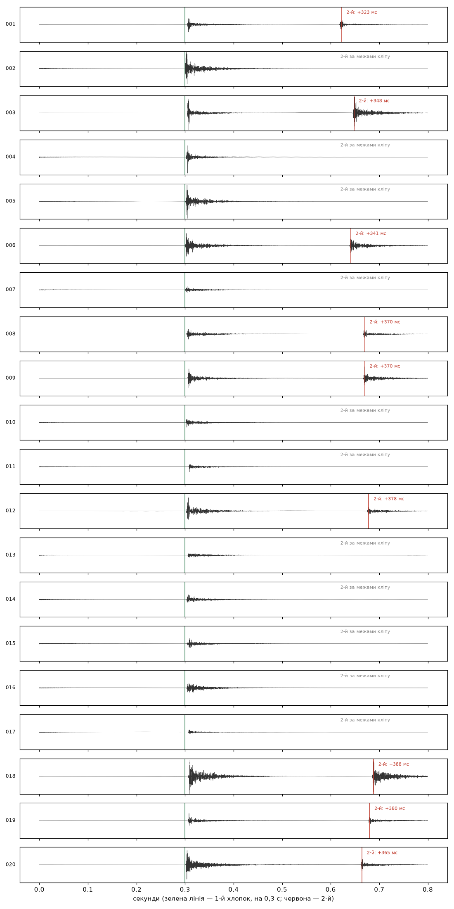

# train — своя модель «хлопок / не хлопок»

Маленька модель поверх ознак із `tools/clap_features.py` (раптовість, дзвінкість 1–4 кГц у момент удару, глухість, спад, фронт, перевантаження). Логістична регресія: на платі це 8 множень. Код свій, не pector.

## Дані

Аудіо лежить у `train/data/` і в git не йде.

| Набір | Що | Скільки | Ліцензія |
|---|---|---|---|
| Наші кліпи з INMP441 | `data/clips/` з Pi, мітки на сторінці `tools/label.py` → `data/labels.csv` | 37 розмічено (24.10) | свої |
| ESC-50 | `clapping` (позитиви) + 15 класів важких негативів: стук, клавіатура, мишка, кроки, бляшанка, скло, годинник, феєрверк, тріск, краплі, кашель, чхання, сміх, хропіння, дихання | 640 кліпів | CC BY-NC 3.0 |
| FSD50K | далі: `Finger_snapping`, `Knock`, `Slam`, `Tap`, шухляди, посуд | — | CC (за кліпом) |

Формат усіх кліпів як на платі: WAV 16 кГц, моно, 16 біт, 0,3 с до удару й 0,5 с після.

```
uv run train/prepare_esc50.py      ESC-50 → train/data/esc50/ (як скачати — у docstring)
uv run train/train_ab.py           моделі A, B, A+B і порівняння
```

**Імітація нашого мікрофона** (`as_our_mic` у `train_ab.py`) для наборів: випадкова гучність від −30 дБ до перевантаження, фон кімнати з тихих кліпів плати, фільтр як у прошивці, 16 біт зі стелею.

## Дві моделі

- **A** — лише набори з імітацією мікрофона.
- **B** — лише наші кліпи з INMP441.
- **A+B** — разом, наші кліпи важать у 5 разів більше.

Перевірка завжди на справжніх кліпах з плати, яких модель не бачила.

24.10, 37 розмічених кліпів (17 хлопків):

| Модель | хлопків почула | хибних |
|---|---|---|
| A: лише набори | 9 / 17 | 3 / 20 |
| B: лише наш мікрофон | 15 / 17 | 3 / 20 |
| A+B | 15 / 17 | 2 / 20 |
| для порівняння: pector + 1–4 кГц у момент удару (межа підібрана на цих же даних) | 16 / 17 | 0 / 20 |

Висновки:

- Самі набори погані: у ESC-50 `clapping` — переважно оплески студійним мікрофоном, не наші хлопки. Наш мікрофон вирішує.
- Набори як добавка трохи допомагають: A+B прибрала обрізане гупання (163313), яке B брала за хлопок.
- Кліпи 163418_187 і 163437_305 усі три моделі вважають хлопками, а мітка «інше» стоїть за правилом «мовчу = вірно». Переслухати.
- Головне обмеження — 37 справжніх міток.

## Записи через /record

24.10, «два хлопки», 20 повторів (`data/clips/2026-10-24/*__два_хлопки_*`). Мітку спершу поставив «хлопок», потім перейменував.



Зелена лінія — удар на 0,3 с від початку кліпу, червона — наступний удар.

- 9 кліпів (1, 3, 6, 8, 9, 12, 18, 19, 20): обидва хлопки, між ними 320–390 мс.
- 11 кліпів: на 0,3 с стоїть **другий** хлопок, а від першого на початку кліпу лишився тільки хвіст, що згасає (фон ~1000 замість ~80). Перший хлопок загубила прошивка: подія закінчується після 300 мс тиші (`CLIP_QUIET_MS`), другий хлопок починає нову подію й обнуляє `post_left` першої, поки її кліп ще не вирізано (`CLIP_POST_MS` 500). Тобто якщо між хлопками ~330–500 мс, лишається тільки кліп другого. Лікується в прошивці: `CLIP_QUIET_MS` ≥ `CLIP_POST_MS` або не обнуляти подію, кліп якої ще чекає.

## 24.10 ввечері: + записи /record і FSD50K

FSD50K: 3526 кліпів (400 хлопків, решта — стук, клацання, мова, посуд, двері…). Справжні з плати: 125 (хлопків 101, не хлопків 24, з них 4 «пальці»).

| Модель | хлопків почула | хибних |
|---|---|---|
| A: лише набори (ESC-50 + FSD50K) | 90 / 101 | 8 / 24 |
| B: лише наш мікрофон | 96 / 101 | 3 / 24 |
| A+B | 95 / 101 | 7 / 24 |

- B знову найкраща. A+B гірша, ніж була: наборів тепер 12,5 тис. прикладів проти 100 своїх, вага 0,2 замала.
- Хибні в B: 2 з 4 клацань пальцями (192400, 192412) і старе гупання 163313. Пальці — найближчий до хлопка звук.
- 24 справжніх негативи — замало, щоб вірити цифрі «хибних». Потрібні записи: ковдра, мова, мова в ритмі, пальці, стіл, двері.
